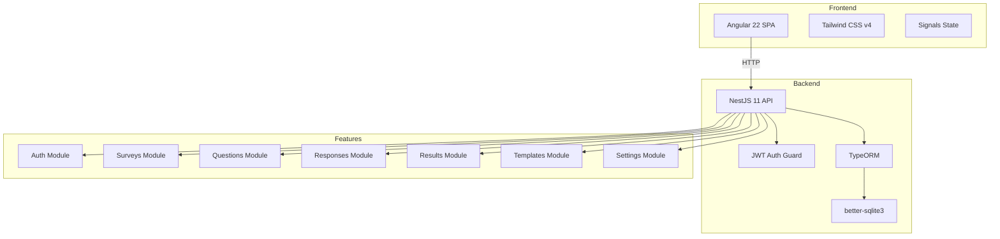

# Architecture

## System Diagram

## Data Flow

1. **Auth:** User registers → org created → JWT returned → stored in localStorage → sent as Bearer header
2. **Surveys:** Creator builds survey in builder → auto-saves draft → publishes → generates shareable slug
3. **Responses:** Respondent opens `/survey/:slug` → fills form → POST answers → response stored with answers
4. **Results:** Creator visits results page → backend aggregates KPIs and chart data → SVG charts rendered

## Key Decisions

- **SQLite for dev, PostgreSQL for prod:** TypeORM abstraction via `better-sqlite3` driver. Switch to `pg` in production.
- **Denormalized counters:** `responseCount` and `completionRate` on Survey entity updated on each response submission to avoid expensive COUNT queries.
- **JSONB for flexible data:** Question options, settings, and Answer values use JSONB for type flexibility.
- **Angular Signals:** All local/component state uses `signal()` and `computed()`. RxJS only at HTTP boundaries via `toSignal()`.
