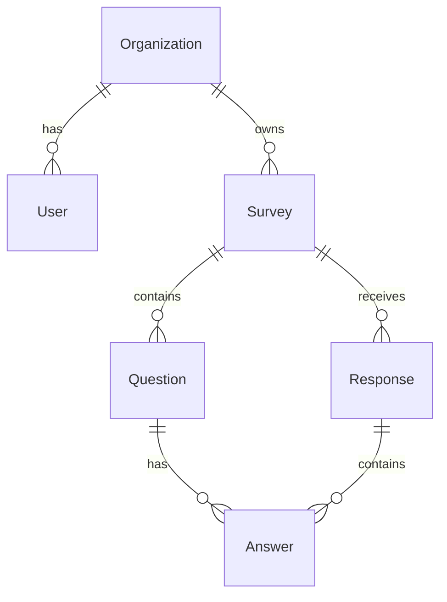

# Database Schema

## ERD

## Entities

7 entities: Organization, User, Survey, Question, Response, Answer, SurveyTemplate

### Key Design Choices

- **UUID primary keys** for all entities — enables safe ID generation without DB roundtrip
- **JSONB for flexible fields:** Question.options, Question.settings, Answer.value, Survey.settings
- **Denormalized responseCount and completionRate** on Survey — updated on each response submission
- **Slug-based public URLs:** `slugify(title) + random 4-char hex suffix`
- **CASCADE deletes:** Deleting a survey cascades to questions, responses, and answers

## Migration Strategy

Currently using TypeORM `synchronize: true` for development. For production:
- Use raw SQL migration files in `apps/api/migrations/`
- Or switch to Drizzle ORM for type-safe migrations
